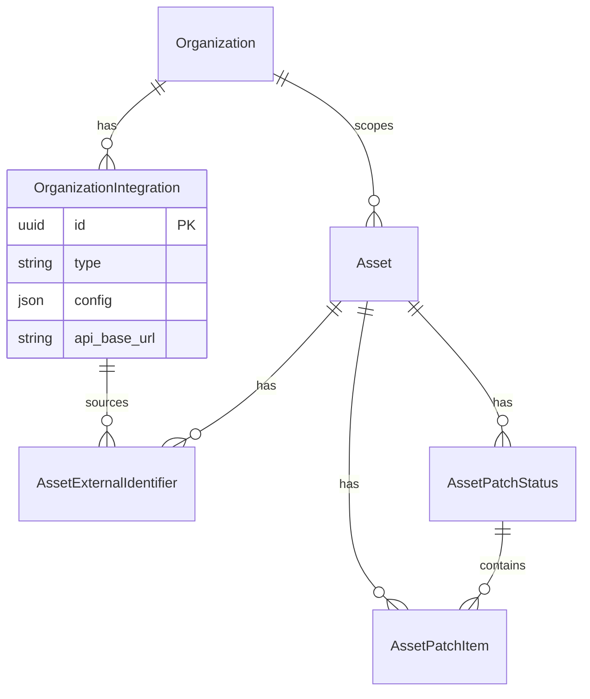
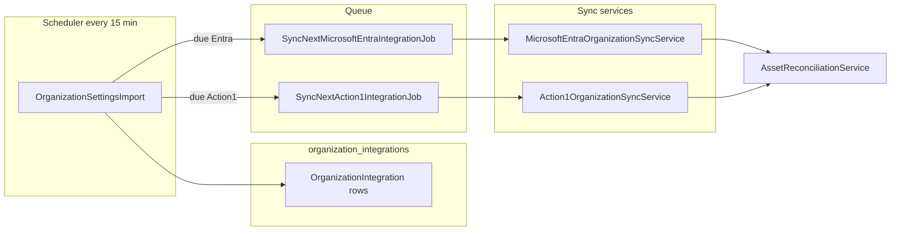
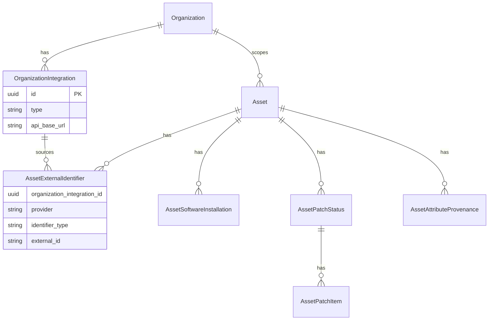
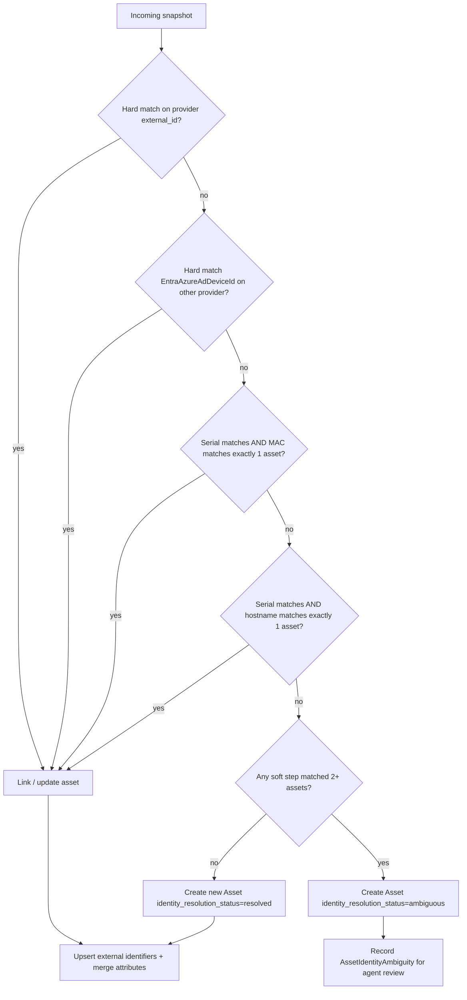

# Multi-source device and asset integration

This document designs how HelixDesk ingests and reconciles device/asset data from **multiple external providers** (Microsoft Entra/Intune, Action1, and future RMM/MDM tools) **without duplicating CMDB records**, while preserving **tenant isolation** and **per-customer integration choice**.

It implements the organization-scoped **`organization_integrations`** table (model `OrganizationIntegration`) sketched in [`technical-architecture.md`](technical-architecture.md) §5.2, replacing the interim JSON-only registry in `organizations.organizational_settings.settings[]`. [`OrganizationIntegrationSettings`](../app/Support/OrganizationIntegrationSettings.php) and [`OrganizationIntegrationRepository`](../app/Repositories/OrganizationIntegrationRepository.php) read and write **only** the table after migration; legacy org JSON is migrated and stripped via Laravel migrations.

**Related docs:** [`domain-model.md`](domain-model.md) §1.2 (Organization), §4 (CMDB), [`project-description.md`](project-description.md) §7.2 (automatic collection), [`roadmap.md`](roadmap.md) Phase C/F.

---

## 1. Overview and goals

### 1.1 Problem

Today, Microsoft Entra sync (`MicrosoftEntraOrganizationSyncService`) writes Intune managed devices directly to `assets`, using `asset_identifier` as the Entra `azureADDeviceId` (falling back to Intune `id`). There is:

- **no multi-provider identity model** — a second RMM cannot link to the same physical device without creating a duplicate `Asset`;
- **no source-of-truth rules** — Entra and Action1 may both supply name, serial, OS, owner, patch state, and installed software with conflicting values;
- **no provenance** — agents cannot see which system last updated a field or whether two records represent one machine;
- **no normalized integration storage** — credentials and sync state live in org JSON, which is hard to query, encrypt consistently, and migrate.

### 1.2 Goals

| Goal                              | Description                                                                                                                                      |
| --------------------------------- | ------------------------------------------------------------------------------------------------------------------------------------------------ |
| **Single canonical asset**        | One `Asset` row per physical/logical CI per tenant + organization scope, regardless of how many providers report it.                             |
| **Provider-agnostic CMDB**        | Canonical fields on `Asset` are integration-neutral; provider-specific IDs and snapshots live in satellite tables.                               |
| **Per-organization integrations** | Each customer org may use different RMM/MDM tools (Entra only, Action1 only, both, or neither).                                                  |
| **Tenant isolation**              | All integration data, external IDs, and sync jobs are scoped by `tenant_id`; no cross-tenant matching.                                           |
| **Extensibility**                 | New providers (Jamf, Datto, NinjaOne, etc.) plug in via a shared sync contract without schema churn.                                             |
| **Operational parity**            | Reuse Entra's scheduling, job, and error-recording patterns (`OrganizationSettingsImport`, targeted sync jobs, config patch on success/failure). |

### 1.3 Non-goals (this design)

- Replacing Entra as the IdP/SSO integration (users already map via `users.entra_object_id`).
- Real-time bidirectional CMDB push to providers (initial scope is **inbound sync** only).
- Per-tenant overrides of the source-of-truth matrix (global config only in v1; see §15).
- Tenant-wide hostname matching for identity resolution (org-scoped only; see §15).

---

## 2. Design principles

### 2.1 Canonical records

`Asset` is the **canonical CI**. External systems never get their own duplicate `Asset` row when identity resolution succeeds. Provider-specific facts that do not belong on the canonical record (installed apps, missing KB list, last agent heartbeat) are stored in **provider-scoped satellite tables** keyed by `(asset_id, organization_integration_id, provider)`.

### 2.2 Provider-agnostic core

Canonical attributes (`name`, `serial_number`, `lifecycle_status`, `owner_user_id`, `organization_id`) are updated through a **source-of-truth matrix** (§6), not by "last writer wins" across all fields.

### 2.3 Tenant-scoped, organization-scoped integrations

- **Tenant** owns all assets and integration configuration.
- **Organization** (customer node in the tree) owns **integration rows** in `organization_integrations` — one row per configured provider connection (Entra, Action1, Google Workspace mail, etc.).
- Each row has a stable UUID `id`, a `type` string, non-secret `config` JSON, encrypted credentials, and sync timestamps.

### 2.4 Explicit provenance

Every canonical field update from a sync should be traceable to `(provider, organization_integration_id, synced_at)`. Satellite rows store full provider payloads or normalized subsets in `metadata_json` for troubleshooting and UI drill-down.

### 2.5 Safe deduplication for monitoring

Monitoring events continue to use `external_reference` + `deduplication_key` per [`MonitoringEventIngestionService`](../app/Services/MonitoringEventIngestionService). Action1 and Entra security alerts use **provider-scoped** `MonitoringEventSource` rows (same pattern as Entra's `microsoft-graph-security-org-{id}` slug).

---

## 3. Integration registry (`organization_integrations`)

### 3.1 Table schema

**Table:** `organization_integrations`  
**Model:** `App\Models\OrganizationIntegration` (extends `TenantModel`)

| Column                     | Type                 | Notes                                                                 |
| -------------------------- | -------------------- | --------------------------------------------------------------------- |
| `id`                       | uuid PK              | Stable integration ID; preserved when migrating from org JSON         |
| `tenant_id`                | FK → `tenants`       | CASCADE                                                               |
| `organization_id`          | FK → `organizations` | CASCADE — customer org that owns this connection                      |
| `type`                     | string               | `microsoft_entra`, `google_workspace`, `action1`, …                   |
| `enabled`                  | bool                 | Master switch (mirrors former `config.enabled`)                       |
| `config`                   | JSON                 | Non-secret settings: scopes, provider org IDs, group filters, labels  |
| `credentials`              | text (encrypted)     | Secret fields only — see §3.4                                         |
| `api_base_url`             | string nullable      | Provider API root; required for Action1 region selection (§8.1)       |
| `last_sync_at`             | timestamp nullable   | Last successful sync                                                  |
| `last_sync_error`          | text nullable        | Truncated error message                                               |
| `sync_interval_hours`      | int nullable         | Override; default from `config/helixdesk_integrations.php`            |
| `created_at`, `updated_at` | timestamps           |                                                                       |

**Indexes:**

- `(tenant_id, organization_id, type)` — list integrations for an org.
- `(tenant_id, enabled, last_sync_at)` — scheduler due-query.
- Unique `(tenant_id, organization_id, type, config->action1_group_id)` when Action1 group scoping is used (see §8.2).

**Relationships:**

- `OrganizationIntegration` belongs to `Tenant`, `Organization`.
- `Organization` has many `OrganizationIntegration`.
- Satellite tables (`asset_external_identifiers`, etc.) reference `organization_integration_id` (uuid FK).



### 3.2 Provider type constants

Centralize in `App\Support\IntegrationType` (or retain on `OrganizationIntegrationSettings` during transition):

| Constant                | Value              | Purpose                                              |
| ----------------------- | ------------------ | ---------------------------------------------------- |
| `TYPE_MICROSOFT_ENTRA`  | `microsoft_entra`  | Directory, Intune devices, Graph security (existing) |
| `TYPE_GOOGLE_WORKSPACE` | `google_workspace` | Mail (existing)                                      |
| `TYPE_ACTION1`          | `action1`          | RMM endpoints, software, patches, alerts             |

Future examples: `ninjaone`, `datto_rmm`, `jamf_pro`, `intune_standalone` (if split from Entra).

### 3.3 Shared config shape (non-secret `config` JSON)

| Key                         | Type           | Description                                                      |
| --------------------------- | -------------- | ---------------------------------------------------------------- |
| `scopes`                    | object         | Provider-specific sync toggles (see §8.3, §9.4)                      |
| `sync_interval_hours`       | int            | Optional override (duplicated column for query convenience)    |

Provider-specific non-secret keys (examples):

| Provider          | Config keys                                                                 |
| ----------------- | --------------------------------------------------------------------------- |
| `microsoft_entra` | `azure_tenant_id`, `scopes.users`, `scopes.computers`, …                  |
| `google_workspace`| `customer_domain`, `delegated_scopes`, `setup_verified_at`, …               |
| `action1`         | `action1_organization_id`, `action1_organization_name`, `action1_group_id` |

Sync timestamps (`last_sync_at`, `last_sync_error`) live on the **row**, not inside `config`.

### 3.4 Credentials (encrypted `credentials` column)

Use **field-level secret encryption** only — Laravel `encrypted:array` cast on the `credentials` column. Non-secret config stays in plain `config` JSON.

| Provider          | `credentials` keys                                      |
| ----------------- | ------------------------------------------------------- |
| `microsoft_entra` | `client_secret`                                         |
| `google_workspace`| `service_account_private_key`                             |
| `action1`         | `client_secret` or `api_key`                            |

Filament forms show masked secret fields on edit; blank submit retains previous value (same pattern as Entra today).

### 3.5 Migration from `organizational_settings.settings[]`

**Migration:** Laravel migrations (not artisan commands) — see §3.5 and §13.

For each `Organization` with `organizational_settings.settings[]` entries (and legacy `integrations.microsoft_entra`):

1. **Read** legacy entry from org JSON (migration-only via `OrganizationIntegrationMigrator`).
2. **Upsert** `organization_integrations` row:
   - Preserve existing UUID `id` from JSON `settings[].id`.
   - Map `type`, `enabled`, scopes, provider IDs into `config`.
   - Extract secrets into `credentials` (encrypted).
   - Map Entra-specific sync fields: `last_entra_sync_at` → `last_sync_at`, `last_entra_sync_error` → `last_sync_error`.
3. **Action1:** set `api_base_url` from config or default US endpoint; set `action1_group_id` when present.
4. **Google Workspace:** migrate mail credentials; no asset sync scopes.
5. **After verification:** remove migrated entries from org JSON (keep non-integration org settings if any remain).

**Dual-read period:** `OrganizationIntegrationRepository` (new) reads table first, falls back to JSON for unmigrated orgs. Filament integration CRUD writes **only** to the table after Phase 1 cutover flag.

**Mail accounts:** `mail_accounts.integration_id` continues to reference the same UUID; no change required when IDs are preserved.

### 3.6 Sync target value objects

Generalize `EntraSyncTarget` into a provider-neutral DTO:

```php
// app/Support/OrganizationIntegrationSyncTarget.php
final class OrganizationIntegrationSyncTarget
{
    public function __construct(
        public int $tenantId,
        public int $organizationId,
        public string $integrationId, // organization_integrations.id
        public string $integrationType,
        public array $config,
        public array $credentials,
        public ?string $apiBaseUrl = null,
    ) {}
}
```

`EntraSyncTarget` becomes a thin alias or is removed during Phase 2 refactor.

### 3.7 Collector and scheduler

Replace JSON-scoped helpers with table queries on `OrganizationIntegration`:

- `OrganizationIntegrationRepository::collectSyncTargets(string $integrationType): list<OrganizationIntegrationSyncTarget>`
- `{type}ImportIsDue(OrganizationIntegration $integration): bool` per provider
- `first{Type}IntegrationDueForImport(): ?OrganizationIntegrationSyncTarget`
- `patchIntegration(OrganizationIntegration $integration, array $configPatch, ?array $credentialsPatch = null): void` — updates row columns and encrypted credentials

`OrganizationSettingsImport` remains a **multi-provider dispatcher**: each schedule tick picks **one** due integration across all registered asset-sync types (round-robin or earliest-due-first).



### 3.8 Tenant integration settings (auto-retire)

**Setting:** `auto_retire_assets_when_all_providers_drop` (bool)

| Aspect        | Value                                                                 |
| ------------- | --------------------------------------------------------------------- |
| **Scope**     | Per tenant (applies to all customer orgs under the tenant)            |
| **Storage**   | `tenants.integration_settings` JSON column (new) or keyed object        |
| **Default**   | `false` — notification only; agents review before retiring            |
| **When true** | After `retirement_grace_days` with no provider reporting any external identifier for the asset, set `lifecycle_status = retired` |
| **Admin UI**  | Agent panel → **Tenant settings** → **Integrations** tab (tenant admin role); toggle + grace period (days) |
| **Service**   | `App\Services\AssetRetirementService` invoked post-sync               |

Related config default in `config/helixdesk_integrations.php`: `identity.retirement_grace_days` (default `30` when auto-retire enabled; ignored when tenant setting is off).

---

## 4. Data model design

### 4.1 `asset_external_identifiers`

Maps canonical assets to provider-specific IDs. Replaces overloading `assets.asset_identifier` with external GUIDs.

| Column                        | Type                 | Notes                                                                |
| ----------------------------- | -------------------- | -------------------------------------------------------------------- |
| `id`                          | bigint PK            |                                                                      |
| `tenant_id`                   | FK → `tenants`       | CASCADE                                                              |
| `asset_id`                    | FK → `assets`        | CASCADE                                                              |
| `organization_id`             | FK → `organizations` | Scope node for the integration entry                                 |
| `organization_integration_id` | uuid FK              | → `organization_integrations.id`                                     |
| `provider`                    | string               | e.g. `microsoft_entra`, `action1`                                    |
| `identifier_type`             | string               | See enum below                                                       |
| `external_id`                 | string               | Provider's ID for this identifier type                               |
| `is_primary`                  | bool                 | One primary identifier per `(asset_id, provider)` for display        |
| `last_seen_at`                | timestamp            | Updated each sync when provider still reports this ID                  |
| `metadata_json`               | JSON nullable        | Raw provider fragment (e.g. Intune `id` alongside `azureADDeviceId`) |
| `created_at`, `updated_at`    | timestamps           |                                                                      |

**Unique constraints:**

- `(tenant_id, provider, identifier_type, external_id)` — same external ID cannot map to two assets.
- `(tenant_id, asset_id, provider, identifier_type, external_id)` — idempotent upserts.

`identifier_type` **enum** (`App\Enums\AssetExternalIdentifierType`):

| Case                         | Used by                  | Example `external_id`                      |
| ---------------------------- | ------------------------ | ------------------------------------------ |
| `EntraAzureAdDeviceId`       | Microsoft Entra / Intune | `azureADDeviceId` GUID                     |
| `EntraIntuneManagedDeviceId` | Microsoft Entra / Intune | Intune `managedDevices.id`                 |
| `EntraDeviceId`              | Microsoft Entra          | Entra device object ID (future)            |
| `Action1EndpointId`          | Action1                  | Action1 endpoint `id`                      |
| `SerialNumber`               | Any                      | Normalized serial (secondary match only)   |
| `Hostname`                   | Any                      | Normalized FQDN/hostname (secondary match) |
| `MacAddress`                 | Any                      | Normalized MAC (secondary match)           |

Primary external IDs used for **hard matching** are provider-native types (`EntraAzureAdDeviceId`, `Action1EndpointId`). `SerialNumber`, `Hostname`, and `MacAddress` are **soft-match hints** stored after resolution for future syncs.

### 4.2 Canonical `assets` adjustments

| Change                                          | Rationale                                                                          |
| ----------------------------------------------- | ---------------------------------------------------------------------------------- |
| Keep `asset_identifier`                         | Human-facing asset tag / internal CMDB ID; **not** the Entra GUID after migration. |
| Add `primary_hostname` nullable string          | Stable display/search field; populated from source-of-truth provider.              |
| Add `operating_system` nullable string          | Normalized OS string (e.g. `Windows 11 Enterprise`).                               |
| Add `last_inventory_sync_at` nullable timestamp | Latest successful inventory merge across providers.                                |
| Add `identity_resolution_status` string         | `resolved`, `ambiguous`, `manual`, `unlinked` (see §5).                            |

Do **not** add provider-specific columns to `assets`.

### 4.3 `asset_software_installations`

Normalized installed software per asset, primarily fed by Action1 (Entra app inventory is out of initial scope).

| Column                        | Type            | Notes                                                 |
| ----------------------------- | --------------- | ----------------------------------------------------- |
| `id`                          | bigint PK       |                                                       |
| `tenant_id`                   | FK              |                                                       |
| `asset_id`                    | FK → `assets`   |                                                       |
| `organization_integration_id` | uuid FK         | Source integration row                                |
| `provider`                    | string          | `action1`, future providers                           |
| `external_id`                 | string nullable | Provider's app/installation ID                        |
| `name`                        | string          | Display name                                          |
| `version`                     | string nullable |                                                       |
| `publisher`                   | string nullable |                                                       |
| `install_date`                | date nullable   |                                                       |
| `source`                      | string          | `discovered`, `deployed` (enum `AssetSoftwareSource`) |
| `last_seen_at`                | timestamp       | Row removed/stale when not seen in N syncs            |
| `metadata_json`               | JSON nullable   |                                                       |
| `created_at`, `updated_at`    | timestamps      |                                                       |

**Unique:** `(tenant_id, asset_id, provider, external_id)` when `external_id` present; fallback hash unique on `(tenant_id, asset_id, provider, name, version)`.

**Stale handling:** After each sync, mark installations not seen as `stale` or delete rows not seen for configurable TTL (default 7 days).

### 4.4 `asset_patch_status` and `asset_patch_items`

**Normalized from v1** — summary row plus per-KB/CVE child rows (not JSON-first).

#### `asset_patch_status` (summary per asset per provider)

| Column                        | Type          | Notes                                                         |
| ----------------------------- | ------------- | ------------------------------------------------------------- |
| `id`                          | bigint PK     |                                                               |
| `tenant_id`                   | FK            |                                                               |
| `asset_id`                    | FK            |                                                               |
| `organization_integration_id` | uuid FK       |                                                               |
| `provider`                    | string        |                                                               |
| `missing_critical_count`      | int           | Denormalized count from child rows                            |
| `missing_other_count`         | int           | Denormalized count from child rows                            |
| `last_assessed_at`            | timestamp     | Provider assessment time                                      |
| `compliance_status`           | string        | `compliant`, `critical_missing`, `updates_missing`, `unknown` |
| `created_at`, `updated_at`    | timestamps    |                                                               |

**Unique:** `(tenant_id, asset_id, provider, organization_integration_id)` — one current summary row; upsert replaces counts after child sync.

#### `asset_patch_items` (KB/CVE rows — v1, not deferred)

| Column                        | Type          | Notes                                              |
| ----------------------------- | ------------- | -------------------------------------------------- |
| `id`                          | bigint PK     |                                                    |
| `tenant_id`                   | FK            |                                                    |
| `asset_patch_status_id`       | FK            | CASCADE                                            |
| `asset_id`                    | FK            | Denormalized for direct asset queries              |
| `organization_integration_id` | uuid FK       |                                                    |
| `provider`                    | string        |                                                    |
| `kb_id`                       | string        | KB/article identifier (e.g. `KB5036893`)           |
| `cve_id`                      | string nullable | CVE when provided                                |
| `title`                       | string        | Update title                                       |
| `severity`                    | string        | `critical`, `important`, `moderate`, `low`, `other` |
| `approval_status`             | string nullable | Provider approval state                        |
| `last_seen_at`                | timestamp     | Removed when not in provider payload               |
| `metadata_json`               | JSON nullable | Raw provider fragment                              |
| `created_at`, `updated_at`    | timestamps    |                                                    |

**Unique:** `(tenant_id, asset_id, provider, organization_integration_id, kb_id)`.

**Sync behaviour:** Upsert items from Action1 extended endpoint data; delete or mark stale items not seen in current sync; refresh summary counts on `asset_patch_status`.

### 4.5 `asset_attribute_provenance`

Lightweight audit of which provider last wrote each canonical field (recommended in Phase 1).

| Column                        | Type      | Notes                                         |
| ----------------------------- | --------- | --------------------------------------------- |
| `id`                          | bigint PK |                                               |
| `tenant_id`                   | FK        |                                               |
| `asset_id`                    | FK        |                                               |
| `attribute`                   | string    | e.g. `name`, `serial_number`, `owner_user_id` |
| `provider`                    | string    |                                               |
| `organization_integration_id` | uuid FK   |                                               |
| `synced_at`                   | timestamp |                                               |

**Unique:** `(tenant_id, asset_id, attribute)`.

### 4.6 Eloquent models

| Model                       | Extends       | Relationships                               |
| --------------------------- | ------------- | ------------------------------------------- |
| `OrganizationIntegration`   | `TenantModel` | `belongsTo Organization`, `belongsTo Tenant` |
| `AssetExternalIdentifier`   | `TenantModel` | `belongsTo Asset`, `belongsTo Organization` |
| `AssetSoftwareInstallation` | `TenantModel` | `belongsTo Asset`                           |
| `AssetPatchStatus`          | `TenantModel` | `belongsTo Asset`, `hasMany AssetPatchItem` |
| `AssetPatchItem`            | `TenantModel` | `belongsTo AssetPatchStatus`, `belongsTo Asset` |
| `AssetAttributeProvenance`  | `TenantModel` | `belongsTo Asset`                           |
| `Asset` (extended)          | —             | `hasMany` for all above                     |

### 4.7 Entity relationship (CMDB + integrations)



---

## 5. Identity resolution algorithm

Implemented in `App\Services\AssetReconciliationService`.

### 5.1 Input

A **provider snapshot** DTO (`App\Data\AssetProviderSnapshot`):

- `tenantId`, `organizationId`, `organizationIntegrationId`, `provider`
- `identifiers`: list of `{ type: AssetExternalIdentifierType, value: string }`
- `attributes`: normalized canonical fields (`name`, `serial_number`, `hostname`, `operating_system`, `owner_user_id`, …)
- `satellite`: software list, patch items (optional)

### 5.2 Matching order (strict)

Within `(tenant_id, organization_id)` scope only — **no tenant-wide hostname matching** (see §15):



**Rule details:**

1. **Provider native ID** — lookup `asset_external_identifiers` where `(tenant_id, provider, identifier_type, external_id)`.
2. **Cross-provider bridge** — if incoming Action1 snapshot includes `EntraAzureAdDeviceId` (Action1 can expose Azure AD device ID when joined), match existing Entra-linked asset.
3. **Serial + corroborating identifier (required)** — serial alone is **never** sufficient for auto-merge. A soft match requires:
   - **Serial number** — case-insensitive trim; exclude empty and generic placeholders (`0`, `Default string`, `To be filled by O.E.M.`), **and**
   - **At least one of:** normalized **MAC address** or normalized **hostname** (short hostname, lowercase) matching the same single candidate asset within the org scope.
4. **Hostname-only or MAC-only** — never sufficient without serial; do not merge.
5. **MAC** — normalize colon/dash format.
6. **Ambiguity** — if serial matches multiple assets even with MAC/hostname, or corroborating ID matches multiple, flag `ambiguous`.

### 5.3 Ambiguity handling

When a soft match hits **multiple** assets:

- Do **not** merge automatically.
- Create or update `asset_identity_ambiguities` (Phase 1 table):

| Column                                                       | Notes                                     |
| ------------------------------------------------------------ | ----------------------------------------- |
| `tenant_id`, `organization_id`, `organization_integration_id`, `provider` |                                           |
| `candidate_asset_ids`                                        | JSON array of asset IDs                   |
| `snapshot_json`                                              | Provider payload                          |
| `status`                                                     | `open`, `resolved`, `dismissed`           |
| `resolved_asset_id`                                          | FK nullable — set when agent picks winner |

- Set affected assets' `identity_resolution_status = ambiguous` until resolved.
- Filament UI (Phase 4): agent picks correct asset or creates new. Ambiguity UI may search tenant-wide for candidates but **matching** stays org-scoped.
- `AssetIdentityAmbiguity` must expose a `tenant()` relationship (like other Agent-panel resource models). Filament tenancy ownership uses that relationship name by default; a missing `tenant()` relation throws when listing or viewing ambiguities.

### 5.4 Unlink and retirement

- If a provider stops reporting an external ID, set `last_seen_at` but **do not** delete the asset; optional stale threshold marks identifier inactive.
- When **all** providers drop an endpoint:
  - **Default (`auto_retire_assets_when_all_providers_drop = false`):** `AssetRetirementService` logs a one-time `retirement_suggested` activity on the asset (agents review before retiring); no automatic status change.
  - **When tenant setting enabled:** after `retirement_grace_days` with no active external identifiers, `AssetRetirementService` sets `lifecycle_status = retired` and logs a `retired` activity (via spatie/laravel-activitylog).

### 5.5 Manual assets

Assets created in Filament without external identifiers have `identity_resolution_status = manual`. First sync that matches links identifiers without overwriting agent-set fields unless source-of-truth grants provider priority.

---

## 6. Source-of-truth matrix

Canonical field updates follow this precedence (highest wins on conflict). Matrix is **global config only** in v1 — no per-tenant overrides (see §15).

| Attribute                  | Primary source                         | Secondary                   | Notes                                                          |
| -------------------------- | -------------------------------------- | --------------------------- | -------------------------------------------------------------- |
| `organization_id`          | Manual / HelixDesk                     | —                           | Sync does not move assets across orgs without explicit mapping |
| `name`                     | Action1 (`deviceName` / endpoint name) | Entra Intune `deviceName`   | Action1 often fresher for RMM-renamed hosts                    |
| `serial_number`            | Action1                                | Entra Intune                | Hardware inventory                                             |
| `primary_hostname`         | Action1                                | Entra                       |                                                                |
| `operating_system`         | Action1                                | Entra                       | Normalize to `"{platform} {version}"`                          |
| `owner_user_id`            | Entra (UPN → `users.email`)            | Action1 `user` field        | Directory is authoritative for person identity                 |
| `lifecycle_status`         | HelixDesk manual                       | Provider `status` hints     | Auto-retire only when tenant setting enabled (§3.8)            |
| `asset_identifier`         | HelixDesk manual                       | —                           | Internal tag; never overwritten by sync                        |
| `asset_type_id`            | HelixDesk                              | Provider `platform` mapping | Map Windows/macOS/Linux → `Computer` type                      |
| Installed software         | Action1                                | —                           | Entra does not feed this in v1                                 |
| Patch compliance           | Action1                                | —                           | Normalized `asset_patch_items` rows                            |
| Security monitoring events | Entra Graph                            | Action1 alerts              | Separate streams; both may link to same asset                  |

Matrix is implemented in `App\Services\AssetAttributeMerger` reading `config/helixdesk_integrations.php` → `source_of_truth`.

---

## 7. Sync architecture

### 7.1 Job pattern (mirror Entra)

| Component      | Entra (today)                                | Action1 (planned)                     |
| -------------- | -------------------------------------------- | ------------------------------------- |
| Scheduler gate | `hasMicrosoftEntraIntegrationDueForImport()` | `hasAction1IntegrationDueForImport()` |
| Dispatcher     | `OrganizationSettingsImport`                 | Same job, multi-provider              |
| Targeted job   | `SyncNextMicrosoftEntraIntegrationJob`       | `SyncNextAction1IntegrationJob`       |
| Service        | `MicrosoftEntraOrganizationSyncService`      | `Action1OrganizationSyncService`      |
| HTTP client    | `MicrosoftGraphHttpClient`                   | `Action1HttpClient`                   |
| Reconciliation | *(inline today)*                             | `AssetReconciliationService` (shared) |

Jobs load integration config from `organization_integrations` (not org JSON) after Phase 1.

### 7.2 Tenant context

Every job must:

1. `TenantContext::setTenantId($target->tenantId)`
2. `setPermissionsTeamId($target->tenantId)`
3. Reset both in `finally` (existing Entra pattern).

Use `Organization::query()->withoutGlobalScopes()` when loading org by ID from queue payload.

### 7.3 Error handling

- One try per job (`$tries = 1`); transient failures wait for next schedule tick.
- On success: patch `last_sync_at`, clear `last_sync_error` on integration row.
- On failure: `recordFailure()` patches `last_sync_error`; log structured context (`tenant_id`, `organization_id`, `organization_integration_id`).
- Rate limits: Action1 API request quotas — implement exponential backoff **within** a single job for paginated fetches; do not dispatch parallel jobs for the same integration id.

### 7.4 Idempotency

- External identifiers: upsert on unique key.
- Software: upsert + stale sweep per sync pass.
- Patch status: summary upsert + child `asset_patch_items` upsert/delete stale.
- Monitoring events: upsert on `(tenant_id, monitoring_event_source_id, external_reference)` (Entra pattern).

### 7.5 Queue priority

Asset inventory sync runs at **medium** priority (same band as monitoring event processing per [`technical-architecture.md`](technical-architecture.md) §4.1).

---

## 8. Action1-specific scope design

### 8.1 Authentication and API regions

- OAuth2 client credentials or API key → JWT (`Authorization: Bearer`).
- Store `client_id` and secret in `credentials`; optional `action1_account_id` in `config`.
- **`api_base_url`** on `organization_integrations` selects the Action1 region. Support multiple endpoints from v1:

| Region | `api_base_url` value                              | Notes                          |
| ------ | ------------------------------------------------- | ------------------------------ |
| US     | `https://app.action1.com/api/3.0/`                | Default                        |
| EU     | `https://app.eu.action1.com/api/3.0/`             | Required for EU test tenant    |

Enum `App\Enums\Action1ApiRegion` maps preset labels → URLs; Filament select writes `api_base_url`. Custom URL override allowed for reseller/partner endpoints.

`Action1HttpClient` receives `apiBaseUrl` from the integration row (not global config alone).

### 8.2 Organization and group mapping

Action1 has its own **organization** concept. Config keys on `organization_integrations.config`:

| Key                         | Description                                                                 |
| --------------------------- | --------------------------------------------------------------------------- |
| `action1_organization_id`   | Target org in Action1                                                       |
| `action1_organization_name` | Cached display label                                                        |
| `action1_group_id`          | Optional — sync **only endpoints in this Action1 group**                    |

**One Action1 org → multiple HelixDesk customers:** when a single Action1 organization serves multiple end customers, create **one HelixDesk integration row per customer**, each with the same `action1_organization_id` but a **different `action1_group_id`**. Sync filters endpoints by group membership before reconciliation.

HelixDesk `Organization` (customer) maps 1:1 to one Action1 group filter per integration entry (not necessarily 1:1 to Action1 org).

### 8.3 Sync scopes (`config.scopes`)

| Scope key   | Default | API / behaviour                                                                               |
| ----------- | ------- | --------------------------------------------------------------------------------------------- |
| `endpoints` | true    | `GET /endpoints/managed/{action1_organization_id}?fields=*` — filter by group when configured |
| `software`  | true    | Endpoint extended fields or dedicated software inventory endpoints                            |
| `patches`   | true    | Missing updates → `asset_patch_items` + summary counts                                        |
| `alerts`    | false   | Security/operational alerts → `MonitoringEvent` (**poll in v1**)                              |

### 8.4 Endpoint field mapping

| Action1 field                                      | HelixDesk destination                                         |
| -------------------------------------------------- | ------------------------------------------------------------- |
| `id`                                               | `AssetExternalIdentifier` type `Action1EndpointId`            |
| `name` / hostname                                  | `name`, `primary_hostname`                                    |
| `serial`                                           | `serial_number`, identifier `SerialNumber`                    |
| MAC address fields                                 | identifier `MacAddress` (required for serial soft-match)      |
| `platform`, OS version                             | `operating_system`                                            |
| `user`                                             | Resolve to `owner_user_id` via email/name match (best effort) |
| `last_seen`                                        | `metadata_json`, drive `lifecycle_status` hints only          |
| `status`, `subscription_status`                    | `metadata_json`                                               |
| Azure AD device ID (if present in extended fields) | `EntraAzureAdDeviceId` identifier for cross-provider match    |
| Missing update entries                             | `asset_patch_items` rows + summary on `asset_patch_status`    |

Group filter: skip endpoints not in `action1_group_id` before building snapshots.

### 8.5 Software inventory

Parse installed applications from Action1 endpoint extended data or package deployment inventory (exact endpoint per API version in implementation). Normalize to `asset_software_installations` rows.

### 8.6 Polling interval

Default `sync_interval_hours = 6` (Action1 inventory changes more frequently than Entra directory). Configurable per integration row.

---

## 9. Microsoft Entra changes required

### 9.1 Stop overloading `asset_identifier`

Refactor `MicrosoftEntraOrganizationSyncService::syncManagedDevices()`:

1. Load integration from `organization_integrations`.
2. Build `AssetProviderSnapshot` from Intune device payload.
3. Call `AssetReconciliationService::reconcile($snapshot)`.
4. Store **both** identifiers when present:
   - `EntraAzureAdDeviceId` ← `azureADDeviceId`
   - `EntraIntuneManagedDeviceId` ← Intune `id`
5. Leave `asset_identifier` null unless tenant uses manual tags (or migrate existing Entra GUIDs — see §13).

### 9.2 User mapping

No change: continue `users.entra_object_id` for directory users.

### 9.3 Security incidents

Continue writing `MonitoringEvent` via org-scoped `MonitoringEventSource` (`provider = microsoft_entra`). Link events to assets when Graph provides device IDs in `azureADDeviceId`, `deviceState`, `affectedDevice`, `deviceDetails`, `devices[]`, or `impactedAssets[]` (via `MonitoringEventAssetLinker`).

### 9.4 Config scopes (unchanged keys)

```php
'scopes' => [
    'users' => bool,
    'departments' => bool,
    'computers' => bool,  // feeds Asset reconciliation
    'security_work_items' => bool,
],
```

---

## 10. Monitoring event integration (Action1)

### 10.1 Event source provisioning

On first alert sync, `firstOrCreate` `MonitoringEventSource`:

- `slug`: `action1-alerts-org-{organization_id}`
- `provider`: `action1`
- `configuration_json`: `{ "organization_id", "organization_integration_id" }`

### 10.2 Ingestion

`Action1OrganizationSyncService::syncAlerts()` maps Action1 alert objects to:

| MonitoringEvent field | Value                                             |
| --------------------- | ------------------------------------------------- |
| `external_reference`  | Action1 alert ID                                  |
| `deduplication_key`   | `action1:{tenant_id}:{integration_id}:{alert_id}` |
| `severity`            | Normalized map (`critical` → `high`, etc.)        |
| `message`             | Alert title + summary                             |
| `status`              | `open` / `closed` from Action1 state              |
| `resolved_at`         | Set when Action1 closes alert                     |

**v1 delivery:** poll on scheduled sync when `scopes.alerts` is enabled (see §15). Webhook ingest deferred to Phase 3+.

Prefer the same upsert pattern as Entra security sync rather than `MonitoringEventIngestionService` (API path remains for webhook/push future).

### 10.3 Asset correlation

When Action1 alert includes `endpoint_id`, resolve `Asset` via `AssetExternalIdentifier` (`Action1EndpointId`). Attach through `monitoring_event_asset` pivot in **Phase 4** (see §15); until then store endpoint id in event `configuration_json`.

---

## 11. Multi-tenant considerations

| Concern                     | Approach                                                                                                                           |
| --------------------------- | ---------------------------------------------------------------------------------------------------------------------------------- |
| **Data isolation**          | All new tables include `tenant_id` with global scope; unique constraints include `tenant_id`.                                      |
| **Per-tenant provider mix** | Tenant A may use Entra-only; Tenant B uses Action1-only; Tenant C uses both for different customer orgs.                           |
| **Credential storage**      | Encrypted `credentials` column on `organization_integrations`; never expose in API/Filament after save (masked fields).            |
| **Sync fairness**           | `OrganizationSettingsImport` cycles across tenants via ordered `collectSyncTargets()` — avoid one tenant starving others.          |
| **Filament access**         | Integration CRUD on `OrganizationResource` (customer edit); tenant admins configure auto-retire on Tenant settings → Integrations.  |
| **API exposure**            | `GET /api/v1/assets/{id}` includes nested `external_identifiers`, `patch_status`, `patch_items`, `software` when `?include=` requested (Phase 4). |

---

## 12. Future RMM provider extensibility

### 12.1 Contract

```php
// app/Contracts/OrganizationAssetSyncProvider.php
interface OrganizationAssetSyncProvider
{
    public function type(): string;

    public function configReadyForSync(OrganizationIntegration $integration): bool;

    public function syncSkipReason(OrganizationIntegration $integration): ?string;

    public function sync(OrganizationIntegrationSyncTarget $target): void;

    public function recordFailure(OrganizationIntegrationSyncTarget $target, \Throwable $e): void;
}
```

Register in `App\Providers\IntegrationServiceProvider`:

```php
$registry->register(IntegrationType::MICROSOFT_ENTRA, MicrosoftEntraOrganizationSyncService::class);
$registry->register(IntegrationType::ACTION1, Action1OrganizationSyncService::class);
```

### 12.2 Adding a provider (checklist)

1. Add `TYPE_*` constant + label + form schema (`OrganizationAction1SettingsSchema`).
2. Implement `*HttpClient` with pagination, rate-limit handling, and per-row `api_base_url` when applicable.
3. Implement `*OrganizationSyncService` → map API to `AssetProviderSnapshot`.
4. Add due-import query on `organization_integrations`.
5. Add `SyncNext*IntegrationJob` + register in dispatcher.
6. Extend `source_of_truth` config and tests.
7. Document API scopes in this file.

### 12.3 Push / webhook path (future)

Optional `POST /api/v1/integrations/{provider}/webhook` verified per integration secret; normalizes to same `AssetProviderSnapshot` / monitoring ingest pipeline.

---

## 13. Migration path from Entra-only asset sync

### 13.1 Integration table migration

1. Deploy `organization_integrations` schema.
2. Run Laravel migrations (`2026_07_14_160716_migrate_organization_integrations_from_json`, etc.) — §3.5.
3. Switch Filament integration pages to read/write table.
4. Update `OrganizationIntegrationSettings` to delegate to `OrganizationIntegrationRepository`.

### 13.2 Asset identifier data migration

One-time Laravel migration `2026_07_14_160719_migrate_entra_asset_identifiers` (via `EntraAssetIdentifierMigrator`):

1. For each `Asset` where `asset_identifier` matches GUID pattern and exists in Intune sync scope:
   - Create `asset_external_identifiers` row (`EntraAzureAdDeviceId`, `organization_integration_id` from org's Entra row).
   - If `asset_identifier` equals Intune id, also store `EntraIntuneManagedDeviceId`.
2. Copy `asset_identifier` → `primary_hostname` **only** when it looks like a hostname; otherwise move GUID to external identifier and **clear** `asset_identifier` (or set to `HD-{id}` generated tag).
3. Log ambiguous rows (multiple assets same serial without corroborating MAC/hostname).

### 13.3 Behavioural cutover

1. Deploy CMDB satellite schema + `AssetReconciliationService`.
2. Run integration + asset identifier migrations.
3. Switch Entra sync to reconciliation path (feature flag `config('helixdesk_integrations.asset_reconciliation_enabled')`).
4. Enable Action1 per pilot org (EU `api_base_url` for test tenant).

### 13.4 Rollback

Feature flag disables reconciliation; Entra reverts to legacy `asset_identifier` matching (keep migration reversible for 30 days). Integration rows remain source of truth for credentials.

---

## 14. Implementation phases

### Phase 1 — Integration table and identity foundation

- [x] Migration: `organization_integrations` (+ `tenants.integration_settings` for auto-retire)
- [x] `OrganizationIntegration` model, `OrganizationIntegrationRepository`, encrypted credentials cast
- [x] Laravel migrations from org JSON (Entra, Google Workspace, Action1) + strip legacy org JSON
- [x] Filament: integration CRUD reads/writes table; preserve UUIDs for `mail_accounts.integration_id`
- [x] Migrations: `asset_external_identifiers`, `asset_software_installations`, `asset_patch_status`, `asset_patch_items`, `asset_attribute_provenance`, `asset_identity_ambiguities`
- [x] `Asset` columns: `primary_hostname`, `operating_system`, `last_inventory_sync_at`, `identity_resolution_status`
- [x] Enums: `AssetExternalIdentifierType`, `AssetIdentityResolutionStatus`, `AssetPatchComplianceStatus`, `Action1ApiRegion`
- [x] `AssetProviderSnapshot`, `AssetReconciliationService` (serial + MAC/hostname rule), `AssetAttributeMerger`
- [x] Tenant settings UI: auto-retire toggle + grace days
- [x] Unit/feature tests for matching rules, ambiguity, migration
- [x] Asset retirement activity logging (`retired` / `retirement_suggested` events on `activity_log`)

### Phase 2 — Entra refactor

- [x] Refactor `MicrosoftEntraOrganizationSyncService` to load `OrganizationIntegration` and use reconciliation
- [x] Generalize `OrganizationIntegrationSyncTarget`; deprecate JSON patch helpers
- [x] Store dual Entra identifiers; stop writing GUID to `asset_identifier`
- [x] Laravel migration `migrate_entra_asset_identifiers`
- [x] Update `MicrosoftEntraIntegrationSyncTest`

### Phase 3 — Action1 provider

- [x] `TYPE_ACTION1` + Filament schema (region select, group id filter)
- [x] `Action1HttpClient` (configurable `api_base_url`), `Action1OrganizationSyncService`
- [x] Group-scoped endpoint filter; EU endpoint in test env
- [x] `SyncNextAction1IntegrationJob`; extend `OrganizationSettingsImport`
- [x] Software + normalized patch items sync; alert poll → `MonitoringEvent`
- [x] Feature tests with HTTP fakes (US + EU base URLs)

### Phase 4 — Agent UI and API

- [x] Filament: Action1 in integration picker; asset infolist shows providers, patch items, software tab
- [x] Ambiguity resolution UI
- [x] `monitoring_event_asset` pivot + link Action1/Entra alerts to assets
- [x] API v1 asset includes (`external_identifiers`, `patch_status`, `patch_items`, `software_installations`)
- [x] Dashboard widget: patch compliance summary per customer org

---

## 15. Resolved design decisions

| #   | Question                                                          | Decision                                                                                                      |
| --- | ----------------------------------------------------------------- | ------------------------------------------------------------------------------------------------------------- |
| 1   | Encrypt entire `config` blob vs per-secret fields?                | **Field-level secret encryption** — `credentials` column with `encrypted:array`; non-secrets in `config` JSON |
| 2   | Auto-merge on serial match when providers disagree on name?       | **Do not merge on serial alone.** Require serial **and** (MAC **or** hostname) matching exactly one asset   |
| 3   | Retire assets when provider drops endpoint?                       | **Tenant-admin configurable** (`auto_retire_assets_when_all_providers_drop`); default **off** (notify only)   |
| 4   | Patch detail storage in v1?                                       | **Normalized rows** — `asset_patch_items` from the start; summary on `asset_patch_status`                     |
| 5   | Action1 alert API availability                                    | **Poll in v1** when `scopes.alerts` enabled; webhooks in Phase 3+                                            |
| 6   | Tenant-level default source-of-truth overrides?                   | **Global config only** in v1 (`config/helixdesk_integrations.php`); no per-tenant matrix overrides            |
| 7   | One Action1 org → multiple HelixDesk customers?                   | **Scope by Action1 group** — one integration row per customer with shared `action1_organization_id`, distinct `action1_group_id` |
| 8   | Integration storage: JSON vs dedicated table?                     | **Dedicated `organization_integrations` table now** — migrate from org JSON in Phase 1; do not defer        |
| 9   | `monitoring_event_asset` pivot timing?                            | **Phase 4** — store endpoint id in event config until pivot exists                                            |
| 10  | Hostname collision across orgs                                    | **Org-scoped matching** for resolution; tenant-wide search only in ambiguity review UI                        |

---

## 16. Configuration reference (planned)

`config/helixdesk_integrations.php`:

```php
return [
    'entra' => [
        'import_interval_hours' => 24,
    ],
    'action1' => [
        'import_interval_hours' => 6,
        'default_api_base_url' => 'https://app.action1.com/api/3.0/',
        'regions' => [
            'us' => 'https://app.action1.com/api/3.0/',
            'eu' => 'https://app.eu.action1.com/api/3.0/',
        ],
    ],
    'asset_reconciliation_enabled' => env('HELIXDESK_ASSET_RECONCILIATION', false),
    'source_of_truth' => [
        'name' => ['action1', 'microsoft_entra'],
        'serial_number' => ['action1', 'microsoft_entra'],
        // global only — no per-tenant overrides in v1
    ],
    'identity' => [
        'serial_blocklist' => ['0', 'Default string', 'To be filled by O.E.M.'],
        'retirement_grace_days' => 30, // used when tenant auto-retire setting is enabled
    ],
];
```

Tenant-level override (stored on `tenants.integration_settings`, not in this file):

```php
[
    'auto_retire_assets_when_all_providers_drop' => false,
    'retirement_grace_days' => 30, // optional override of global default
]
```

---

*Last updated: 2026-07-14 — Phases 1–4 complete; retirement activity logging and Entra security asset linking implemented.*
